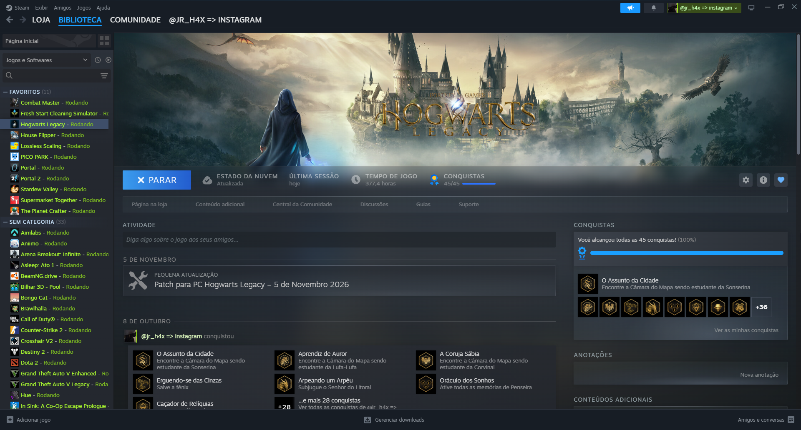

<p align="center">
  
</p>

<h1 align="center">PRIV8 — Steam Hour Farm</h1>

<p align="center">
  <strong>Simultaneous Background Steam Playtime & Hour Farming Tool</strong>
</p>

PRIV8 Steam Hour Farm is a lightweight, dedicated application designed to farm playtime hours and card drops on Steam across multiple games simultaneously. It runs headlessly in the background without needing to download, install, or launch the actual game clients, consuming virtually zero CPU and GPU resources.

## Features

- **Multi-Game Simultaneous Idling**: Farm playtime hours for several games at the exact same time on a single Steam account.
- **Zero Resource Footprint**: Does not render 3D graphics or launch game windows; operates completely in the background via lightweight native Steamworks processes.
- **No Game Installation Required**: Works as long as the games are in your Steam library — you never need to download gigabytes of game files.
- **Automated Periodic Restart**: Built-in scheduler that automatically terminates and relaunches idle processes at custom intervals (e.g., every 1 hour, 2 hours, etc.) to keep Steam sessions fresh and prevent dropped tracking.
- **Real-Time Elapsed Time Tracking**: Live monitoring dashboard displaying individual timers (Hours:Minutes:Seconds), active Process IDs (PIDs), and running status for every game.
- **Automatic Persistence**: Automatically saves your configured AppID list and restart settings between sessions.
- **Safe & Clean Shutdown**: Single-click button to stop and gracefully terminate all active idle processes.

## Screenshots

### Loader / Authentication


### Control Panel


### Active Farming Session



## How to Use

### 1. Requirements
- Ensure the official **Steam Client** is installed, running, and logged into your account.
- Launch `Priv8 - Steam Hour Farm.exe` and authenticate using your access key.

### 2. Adding Game AppIDs
Each game on Steam has a unique numeric identifier called an **AppID** (you can find it in the game's store URL, e.g., `store.steampowered.com/app/730/` has AppID `730`).

In the **Game AppIDs** text box:
- Enter your game AppIDs.
- You can format them by putting **one AppID per line** (press Enter / line break) or by separating them with commas or spaces.

**Example (One per line):**
```text
730
440
570
105600
252490
```

### 3. Configuring Periodic Auto-Restart
Some Steam sessions can experience dropped tracking or socket timeouts after several consecutive hours. PRIV8 includes an automated periodic restart system to prevent this:

1. Check the box **"Restart games every"** (`Reiniciar jogos a cada`).
2. Set your desired interval in hours using the numeric selector (e.g., `1` for every 1 hour, `2` for every 2 hours).
3. The dashboard will display a live countdown showing the time remaining until the next automatic restart (`Next restart`).
4. When the timer expires, PRIV8 will smoothly stop the idle processes and relaunch them within seconds, refreshing your Steam session seamlessly.

### 4. Starting the Farm
- Click **Start** (`Iniciar`). PRIV8 will initialize each AppID sequentially with a short safety delay to avoid rate-limiting.
- The list at the bottom will display the live running state, AppID, and elapsed farming time.
- Click **Stop All** (`Parar Todos`) at any time to safely terminate all background processes.

## Access & Authentication

A valid authentication key is required to access PRIV8.

Free access keys are available at:

**https://phsldev.eu.org/**

## Compatibility

- Works with all Steam accounts on Windows (x86 / x64).
- Compatible with Steam Client (Steamworks API).

## Developer

**jrh4x** &nbsp;

## Download

<p align="center">
  <a href="https://github.com/jrh4x/priv8-steam-hour-farm/raw/refs/heads/main/Priv8%20-%20Steam%20Hour%20Farm.exe">
    <strong>DOWNLOAD PRIV8</strong>
  </a>
</p>

---

*PRIV8 is an independent community project. It is not affiliated with, endorsed by, or sponsored by Valve Corporation or Steam.*
