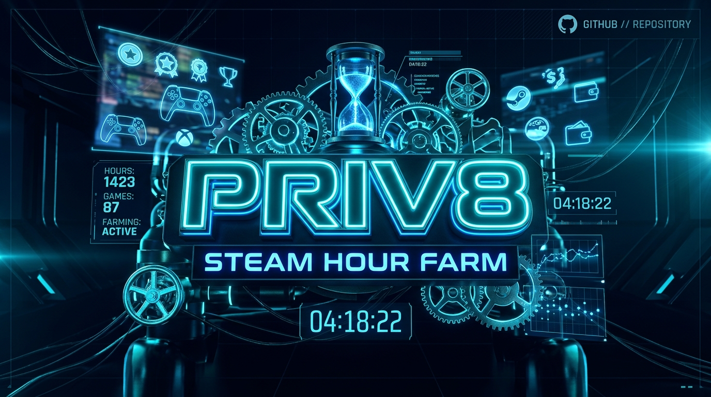
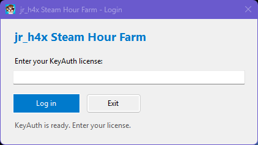
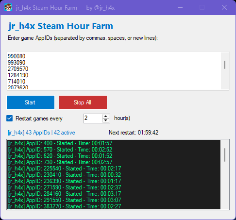

  

<h1 align="center">PRIV8 — Portal</h1>

  <strong>Advanced Gameplay Customization & Experiment Control</strong>

PRIV8 is a dedicated tool for Portal (Source Engine / Valve), featuring a hardware-accelerated DirectX 11 Dear ImGui control panel and an integrated native x86 module providing flight, physics manipulation, visual diagnostics, entity ESP, and object spawning.

## Features

- **Movement & Physics**
  - **Flight + Noclip**: Move freely in any direction through chamber walls, doors, and glass barriers.
  - **Player Speed**: Real-time locomotion and noclip speed multiplier (0.25x to 5.0x).
  - **Gravity Manipulation**: Fine-tune world gravity (0 to 1600 u/s²) with one-click presets: **Moon** (150 u/s²), **Normal** (600 u/s²), and **Heavy** (1200 u/s²).
  - **Position Save & Teleport**: Save your coordinates anywhere in the current test chamber and instantly teleport back.

- **Player Protection & Simulation**
  - **Invulnerability (God Mode)**: Complete immunity to fall damage, energy balls, toxic goo, and environmental hazards.
  - **NPC Invisibility (Notarget)**: Sentry turrets and security cameras ignore the player completely.
  - **Time Scale Controller**: Adjust simulation speed from slow-motion (0.10x) up to accelerated (3.0x).

- **Laboratory & Object Spawner**
  - **Spawn Test Cube**: Spawns a physical Weighted Storage Cube directly in front of the player.
  - **Spawn Metal Sphere**: Spawns a physical metal test sphere.
  - Clean object tracking and reset manager.

- **Visual & Map Inspection**
  - **Full Brightness** (`mat_fullbright`): Disables dark shadows and reveals entire test chambers clearly.
  - **Wireframe Mode** (`mat_wireframe`): Renders level geometry and brush wireframes in real time.
  - **Coordinate Overlay** (`cl_showpos`): Displays live player position and velocity vectors.

- **DirectX Viewport ESP Overlay**
  - Layered viewport-projected ESP overlay synchronized with game frames.
  - **ESP Snaplines**: Tracing lines from screen bottom to tracked entities.
  - **ESP Names & Labels**: Shows object classifications and model names.
  - **Filterable Entity Categories**:
    - **Portals**: Blue and Orange active portals.
    - **Cubes & Spheres**: Weighted storage cubes, companion cubes, and spheres.
    - **Doors & Platforms**: Chamber doors and moving linear platforms.
    - **Actors**: Player, Sentry Turrets, and NPCs.
    - **Interactive Objects**: Buttons, pedestals, and puzzle elements.

- **Diagnostics & Native Console**
  - Real-time display of player HP, active spawned entities, and exact X, Y, Z coordinates.
  - **Restore Controls**: Safely restores all modified engine ConVars and player properties to original values.
  - **Safe DLL Unload**: Cleanly detaches hooks and unloads without restarting the game.

- **Default Hotkeys**
  - `Insert` — Show / hide control panel
  - `Ctrl + Alt + N` — Toggle Flight / Noclip
  - `Ctrl + Alt + G` — Toggle Invulnerability (God Mode)
  - `Ctrl + Alt + T` — Toggle Time Scale (Slow Motion)

## Screenshots

### Loader / Authentication

### In-Game Control Panel

### In-Game ESP & Gameplay

## Access & Authentication

A valid authentication key is required to access PRIV8.

Free access keys are available at:

**https://phsldev.eu.org/**

## Compatibility

Designed for **Portal** (build 1745010, Steam x86).

## Developer

**jrh4x** &nbsp;

## Download

  <a href="https://github.com/jrh4x/priv8-portal-loader/raw/refs/heads/main/Priv8%20-%20Portal.exe">
    <strong>DOWNLOAD PRIV8</strong>
  </a>

---

*PRIV8 is an independent community project. It is not affiliated with, endorsed by, or sponsored by Valve Corporation.*